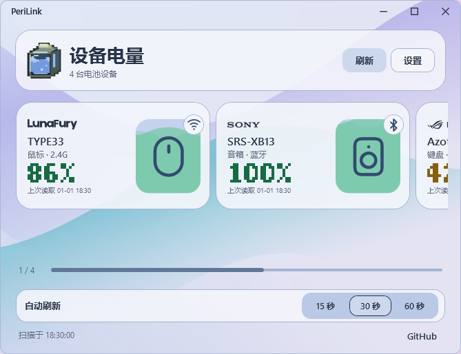

# PeriLink · 外设电量

Windows 10/11 便携版。打开 `PeriLink-17.exe` 查看已识别的电池设备。普通有线供电设备会隐藏，尚未上报电量的已识别无线外设显示短横线。

[下载最新版](https://github.com/Cherishia/PeriLink/releases/latest) · [反馈问题](https://github.com/Cherishia/PeriLink/issues)

- **电量卡片**可拖动卡片区下方的滑动条横向浏览。卡片全部排开时会收起滑动条。每张卡片显示连接方式、上次成功读取的时间和当前电量。50% 及以上使用绿色，21% 到 49% 使用黄色，20% 及以下使用红色。悬停在有电量的水波卡片上时水面流动。充电时持续流动并显示闪电。
- **窗口**使用 Windows 式右上角按钮。在主页点「刷新」旁的「设置」时，主窗口渐暗，设置面板和内容依次进入。
- **设置**可以跟随 Windows 的浅色或深色，也可以手动选择。支持自定义主题色、纯色、柔雾和液态玻璃材质，以及月夜、深海、极光、星空、烟雾、微光和柔光七种动态背景。液态玻璃使用半透明底色与下方窗口合成，指针高光可以关闭。
- **显示样式**里的水波、电量条、圆环和简约会同时应用到主窗口和托盘卡片。省电模式暂停动效，最小化时暂停背景绘制。
- **托盘**悬停显示电量面板，单击固定，再单击收起。拖住标题可移动面板，松开后保存位置。双击托盘图标打开主窗口，右击打开同主题、同材质的菜单。关闭主窗口可继续在托盘运行。选择「退出 PeriLink」会结束程序。
- **自动刷新**可选 15、30、60 秒。设置里的「托盘卡片」可以选择要显示的 1 到 8 台设备。
- **开机自启**默认关闭。托盘右键菜单和设置的「开机自启」都可切换同一个启动项。把新版放在旧版的同一目录可继续使用原配置。更新可执行文件路径后，可在新版设置里开启自启来注册新路径。

兼容标准蓝牙、部分 HID、XInput 和部分 Logitech、Razer、LunaFury、ROG 接收器。电量取决于型号和连接方式。配置和历史保存在程序旁的 `LinkScope.refresh`、`LinkScope.ui`、`LinkScope.readings` 和 `LinkScope.profiles`。

品牌素材用于标识设备。来源包括 [Simple Icons](https://github.com/simple-icons/simple-icons)、[LunaFury](https://www.lunafury.games/)、[Sony 字标](https://commons.wikimedia.org/wiki/File:Sony_logo.svg)、[ATK](https://www.atk.store/)、[VGN](https://vgnlab.com/)、[MCHOSE](https://www.mchose.store/)、[雷柏](https://www.rapoo.com/) 和 [GameSir](https://gamesir.com/)。

在 Windows PowerShell 中运行 `.\build.ps1` 可生成 `PeriLink.exe`。使用 Windows 自带的 .NET Framework 编译器和 WPF。
